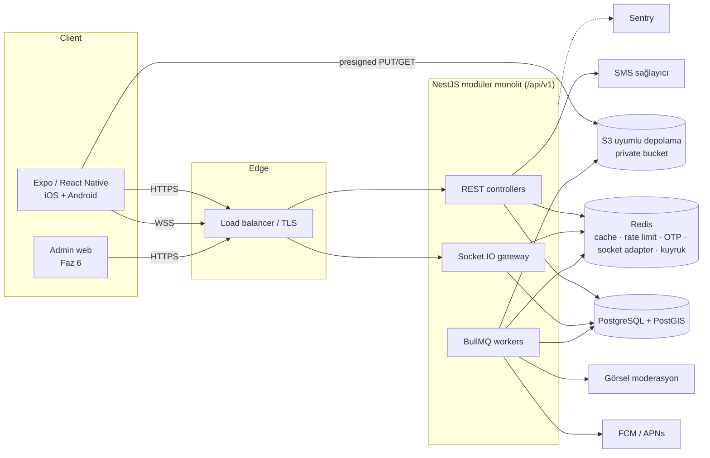
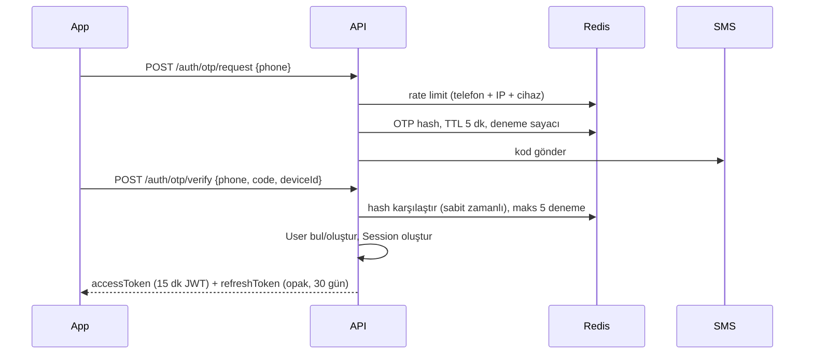

# 01 — Teknik Mimari

Durum: **Taslak, onay bekliyor** · Kararlar: [ACIK-KARARLAR.md](ACIK-KARARLAR.md) (K1–K4)

## 1. Genel bakış



- **Modüler monolit**: tek deploy edilebilir NestJS uygulaması; API süreci ve worker süreci aynı kod tabanından iki giriş noktasıyla çalışır (`main.ts`, `worker.ts`). Mikroservis yok.
- Mobil uygulama **yalnızca API** ile konuşur. Veritabanı, Redis veya gizli anahtarlar mobilde yok. Medya, API'nin ürettiği kısa ömürlü presigned URL'lerle doğrudan S3'e yüklenir/indirilir.
- Yatay ölçek: API süreçleri durumsuz; Socket.IO Redis adapter ile çok süreçte çalışır.

## 2. Mobil uygulama

| Konu            | Seçim                                                                                                                                  |
| --------------- | -------------------------------------------------------------------------------------------------------------------------------------- |
| Çatı            | Expo (güncel SDK — Faz 1'de `package.json` ve sürüme özel Expo dokümanından doğrulanacak), TypeScript strict                           |
| Yönlendirme     | Expo Router, rotalar `apps/mobile/src/app/` altında                                                                                    |
| Sunucu durumu   | TanStack Query (cache, sonsuz kaydırma, optimistic like/pass)                                                                          |
| İstemci durumu  | Zustand (oturum, UI tercihleri) — sunucu verisi Zustand'a kopyalanmaz                                                                  |
| Formlar         | React Hook Form + Zod (yalnızca UX doğrulaması; otorite sunucu)                                                                        |
| Token saklama   | `expo-secure-store` (refresh token); access token yalnızca bellekte                                                                    |
| Gerçek zamanlı  | `socket.io-client`, access token ile handshake                                                                                         |
| Push            | Yerel FCM/APNs token'ı → `POST /devices`                                                                                               |
| Hata izleme     | Sentry (PII temizleme açık)                                                                                                            |
| Tasarım sistemi | `packages/ui` değil, başlangıçta `apps/mobile/src/design/` (token, tipografi, bileşenler). Paylaşım ihtiyacı doğarsa pakete çıkarılır. |

Ana sekmeler (brief §9): **Keşfet, Eşleşmeler, Voice, Planlar, Profil**. MVP'de Voice ve Planlar sekmeleri gösterilmez (yer tutucu ekran yok — brief §10 "sahte işlevsellik yok"); MVP sekmeleri: Keşfet, Eşleşmeler (sohbetler dahil), Profil.

API sözleşmesi: Nest Swagger'dan üretilen OpenAPI → `openapi-typescript` ile mobil için tipler. Elle yazılmış DTO tipi kopyası yok.

## 3. Backend katmanları

Her modülde:

```
modules/<modül>/
  <modül>.module.ts
  <modül>.controller.ts     # HTTP, yalnızca girdi/çıktı eşleme
  <modül>.service.ts        # iş kuralları (tek kaynak)
  <modül>.repository.ts     # Prisma / ham SQL (PostGIS) erişimi
  dto/                      # class-validator DTO'ları + Swagger dekoratörleri
  <modül>.policy.ts         # erişim kuralları (ör. "bu sohbetin katılımcısı mı?")
  __tests__/
```

- Modüller birbirinin repository'sine dokunmaz; yalnızca dışa açılmış service arayüzleri üzerinden konuşur.
- Döngüsel bağımlılık yerine **domain olayları** (`@nestjs/event-emitter` süreç içi, ağır işler BullMQ): ör. `match.created` → Chat sohbet açar, Notifications push gönderir.
- Ortak çapraz kesenler (`common/`): config (Zod ile doğrulanmış env), hata filtresi, istek kimliği, log redaksiyonu, rate limit guard, auth guard, roller, sayfalama.

## 4. Kimlik doğrulama (K2: Telefon OTP)



- **Telefon numarası**: `phoneHash` (HMAC-SHA256, gizli anahtar ile; arama/unique için) + `phoneEncrypted` (AES-256-GCM; SMS gönderimi için). Düz metin numara DB'de yok.
- **Access token**: kısa ömürlü JWT (sub, sessionId, role). **Refresh token**: rastgele 256 bit, DB'de yalnızca SHA-256 hash'i (`Session`). Her yenilemede **rotasyon**; eski token tekrar kullanılırsa tüm aile (session) iptal edilir (token çalınma tespiti).
- Çıkış, oturum listesi, tek oturum iptali, hesap askıya alınınca tüm oturumların iptali.
- **SIM swap / numara devri**: yeni cihazdan girişte, hesabın son aktifliği eskiyse ek doğrulama (selfie) — Faz 6.
- **Admin**: ayrı `AdminUser` tablosu, e-posta + argon2id parola + TOTP zorunlu, ayrı JWT audience. Kullanıcı token'ı admin uçlarına erişemez.

## 5. Modüller

| #    | Modül             | Sorumluluk                                                                                                                     | MVP       |
| ---- | ----------------- | ------------------------------------------------------------------------------------------------------------------------------ | --------- |
| 5.1  | **Auth**          | OTP, oturumlar, token yenileme, admin girişi                                                                                   | ✅        |
| 5.2  | **Users**         | Hesap durumu, doğum tarihi/yaş kapısı, rızalar, hesap silme, veri dışa aktarma                                                 | ✅        |
| 5.3  | **Profiles**      | Profil alanları, ilgi alanları, tercihler, fotoğraf yükleme/sıralama, konum güncelleme                                         | ✅        |
| 5.4  | **Discovery**     | Uygunluk filtreleri + puanlama, aday listesi, açıklamalar                                                                      | ✅        |
| 5.5  | **Matching**      | Like/Pass, karşılıklı beğenide eşleşme, unmatch                                                                                | ✅        |
| 5.6  | **Chat**          | Sohbet, mesaj, okundu bilgisi, Socket.IO gateway                                                                               | ✅        |
| 5.7  | **Safety**        | Engelleme, şikayet, fotoğraf/metin moderasyonu, doğrulama                                                                      | ✅        |
| 5.8  | **Notifications** | Cihaz kaydı, push, uygulama içi bildirimler, tercihler                                                                         | ✅        |
| 5.9  | **Admin**         | Moderasyon kuyruğu, kullanıcı işlemleri, denetim kaydı                                                                         | ✅        |
| 5.10 | **AI**            | Kural tabanlı açıklamalar MVP'de Discovery içinde; LLM sağlayıcı adaptörü Faz 9                                                | Kısmi     |
| 5.11 | Voice             | Ses profili yükleme, moderasyon                                                                                                | Faz 10    |
| 5.12 | Games             | Soru setleri, oyun oturumları, cevaplar                                                                                        | Faz 11    |
| 5.13 | Plans / Groups    | Buluşma planları, ikili gruplar (Double Date)                                                                                  | Faz 12–13 |
| 5.14 | Payments          | IAP makbuz doğrulama (RevenueCat veya doğrudan App Store Server API / Google Play Developer API), yetki (entitlement) kontrolü | Faz 8     |

**Ödeme notu:** Dijital abonelik iOS ve Android'de mağaza içi satın alma ile satılmalıdır (Apple / Google kuralları). Yetki kaynağı her zaman **sunucu**dur: mağaza bildirimleri (App Store Server Notifications, Google RTDN veya RevenueCat webhook'u) imza doğrulamasıyla alınır, `Subscription` güncellenir. Mobil "premium mu?" kararını kendisi vermez.

## 6. Keşfet ve eşleşme algoritması

**1) Sert filtreler (SQL'de):** aktif + görünür hesap · 18+ · karşılıklı yaş tercihi · karşılıklı cinsiyet tercihi (yalnızca rıza varsa; aksi halde bkz. açık karar #2) · mesafe ≤ tercih · iki yönlü engel yok · daha önce beğenilmemiş · pass süresi dolmamış · zaten eşleşmemiş · onaylı en az 1 fotoğraf · askıya alınmamış.

**2) Puanlama (TypeScript, saf fonksiyon, `packages/matching` veya `modules/discovery/scoring/`):**

| Bileşen                                  | Ağırlık (başlangıç) |
| ---------------------------------------- | ------------------- |
| Ortak ilgi alanları (Jaccard)            | 0.30                |
| İlişki beklentisi uyumu                  | 0.25                |
| Yaşam tarzı (sigara, alkol, spor, çocuk) | 0.20                |
| İletişim tarzı                           | 0.10                |
| Mesafe (yakın = yüksek)                  | 0.10                |
| Son aktiflik                             | 0.05                |

- Deterministik, AI sağlayıcısı olmadan birim test edilebilir. Ağırlıklar config'de.
- **Açıklama** puan bileşenlerinden üretilir: "3 ortak ilgi alanı: kahve, trekking, caz" · "İkiniz de uzun süreli ilişki arıyorsunuz". "Bilimsel uyum" iddiası yok.
- Çıkarım yok: yalnızca kullanıcının açıkça girdiği ve kullanılmasına rıza verdiği alanlar.
- Sonuçlar 15 dk Redis'te cache'lenir (aday id listesi), like/pass/block olaylarında geçersiz kılınır.

**Konum gizliliği (trilateration koruması):**

- İstemci konumu gönderir; sunucu **tam koordinatı saklamaz**: ~1 km ızgaraya yuvarlar ve kullanıcıya özgü sabit, gizli tohumlu ≤ 500 m sapma ekler; `Profile.location` (PostGIS `geography`) yalnızca bu değeri tutar.
- Diğer kullanıcılara koordinat asla dönmez; mesafe **tam km'ye yuvarlanır**, minimum "2 km'den yakın", üst sınır "100+ km".
- Konum güncellemeleri rate limit'li (ör. saatte 4), böylece hareket ettirilerek mesafe ölçme zorlaşır.
- Şehir/ilçe adı profil üzerinde ayrıca, kullanıcının seçtiği hassasiyette gösterilir.

**Eşleşme bütünlüğü:**

- `Like` ve `Pass` → `@@unique([actorId, targetId])`; tekrar istek idempotent.
- Like işlemi tek transaction'da: like ekle → karşı like var mı? → varsa `Match` (`userAId = min`, `userBId = max`, unique + `CHECK (userAId < userBId)`) ve `Conversation` oluştur. Yarış durumunda unique ihlali yakalanıp mevcut eşleşme döner.

## 7. Güvenlik, gizlilik ve uyum

### 7.1 Uygulama güvenliği

- Girdi doğrulama: global `ValidationPipe` (whitelist, forbidNonWhitelisted).
- Rate limit: Redis tabanlı, uç bazında (OTP: telefon başına 3/15 dk, IP başına 10/saat; like: dakikada 60; mesaj: dakikada 30; şikayet: saatte 10).
- Yetkilendirme: her kaynak erişimi `*.policy.ts` ile sunucuda; sohbet/mesaj için katılımcı kontrolü + engel kontrolü. ID tahmini (IDOR) testleri zorunlu.
- Medya: private bucket; yükleme için tek kullanımlık, içerik tipi ve boyut sınırlı presigned PUT; görüntüleme için 10 dk presigned GET; EXIF/konum metadata'sı worker'da silinir.
- Loglama: pino + redaksiyon listesi (authorization, token, phone, code, message body, konum). Mesaj içeriği asla loglanmaz.
- Gizli anahtarlar: env + bulut secret manager; repo'da yalnızca `.env.example`.
- Admin işlemleri `AuditLog`'a (kim, ne, hangi hedef, IP, zaman).

### 7.2 KVKK / GDPR — özel nitelikli veri ve rıza

- **Cinsel yönelim / aranan cinsiyet** KVKK m.6 kapsamında özel nitelikli veri (cinsel hayat) olarak ele alınır → ayrı, ayrıntılı, geri alınabilir **açık rıza** (`ConsentRecord`, tip `SPECIAL_CATEGORY_ORIENTATION`, metin sürümü ile). Rıza geri alınırsa ilgili alanlar silinir ve keşfet buna göre çalışır.
- Rıza türleri: aydınlatma okundu (rıza değil, kayıt), özel nitelikli veri, yurt dışı aktarım (gerekiyorsa), pazarlama bildirimleri, konum kullanımı.
- Veri minimizasyonu: gerçek ad, e-posta, tam adres, kimlik numarası tutulmaz. Doğum tarihi tutulur (yaş kapısı), profilde yalnızca yaş görünür.
- Hak talepleri: `GET /privacy/export` (asenkron, JSON + medya bağlantıları), `DELETE /users/me` (30 gün sonra kalıcı silme işi), rıza geri alma.
- Saklama süreleri (taslak): silinen hesap verisi 30 gün; şikayet kanıtları kapanıştan sonra 2 yıl (hukuki teyit); erişim logları 5651 süresince.

### 7.3 Yurt dışına veri aktarımı

Her alt işleyici için envanter tutulur (`docs/` altında Faz 7'de): S3 bölgesi, Sentry, FCM/APNs, SMS, moderasyon, AI sağlayıcısı. 2024 KVKK değişikliğiyle yurt dışı aktarım için yeterlilik kararı yoksa **standart sözleşme** (Kurum'a bildirimli) ana yol; arızi aktarımlarda açık rıza. Azaltımlar: barındırma kararı (açık karar #8), Sentry'de PII kapalı + sunucu tarafı scrubbing, push içeriğinde mesaj metni yok ("Yeni mesajın var"), AI sağlayıcısına kimlik bilgisi gönderilmez. **Hukuki teyit gerekli.**

### 7.4 5651 sayılı kanun

- Erişim/trafik logları (`AccessLog`: kullanıcı id, IP, port, zaman, işlem türü) ayrı tabloda, değiştirilemez (yalnızca insert), mevzuattaki süre boyunca saklanır, sonra otomatik silinir.
- İçerik kaldırma: admin panelinden kaldırma + kanıt saklama + `AuditLog`. Resmi kaldırma kararları için süreç ve iletişim kanalı Faz 7'de tanımlanır.
- Kullanıcı sayısı eşiği aşılırsa (sosyal ağ sağlayıcı yükümlülükleri) ek gereklilikler değerlendirilir. **Hukuki teyit gerekli.**

### 7.5 18+ doğrulama

Katmanlı yaklaşım:

1. Kayıt sırasında doğum tarihi; 18 altı → kayıt reddedilir, aynı `phoneHash` için 30 gün yeniden deneme engeli.
2. Mağaza yaş derecelendirmesi 18+; mağazaların yaş sinyali API'leri (ör. Apple Declared Age Range, Google Play Age Signals) mevcut ve uygulanabilirse kullanılır (Faz 7'de güncel durum doğrulanacak).
3. Fotoğraf moderasyonunda "reşit olmayan görünümlü kişi" sinyali → manuel inceleme kuyruğu.
4. Selfie + canlılık doğrulaması (`Verification`): rozet; şüpheli/şikayet edilen hesaplarda zorunlu (açık karar #1).
5. "Reşit olmayan kullanıcı" şikayet nedeni en yüksek öncelikte; hesap inceleme bitene kadar keşfetten gizlenir.

### 7.6 Moderasyon

- **Fotoğraf**: yükleme → `PENDING` → worker otomatik moderasyon (çıplaklık, şiddet, reşit olmayan, yüz yok) → `APPROVED` / `REJECTED` / `NEEDS_REVIEW`. Onaylanmamış fotoğraf başkalarına gösterilmez. Sonuçlar `ModerationDecision`'a.
- **Metin** (bio, mesaj): kara liste + bağlantı/telefon paylaşım tespiti (dolandırıcılık), şüpheli mesajlarda alıcıya uyarı; mesaj içerikleri yalnızca şikayet edilirse moderatör tarafından görülebilir.
- **Şikayet**: neden + bağlam (profil/mesaj/fotoğraf) → kanıt anlık görüntüsü kaydedilir (silme sonrası da inceleme mümkün) → öncelikli kuyruk.

## 8. Gözlemlenebilirlik ve operasyon

- Sentry (API + mobil), yapılandırılmış JSON loglar, istek kimliği (`x-request-id`).
- `/health/live`, `/health/ready` (DB, Redis).
- Metrikler: OTP başarı oranı, eşleşme oranı, mesaj gecikmesi, moderasyon kuyruk süresi.
- CI (GitHub Actions): lint, typecheck, birim + entegrasyon testleri (Docker'da Postgres/PostGIS + Redis), Prisma migration kontrolü, OpenAPI farkı.
- Ortamlar: local (docker compose), staging, production. Mobil: EAS Build profilleri (development / preview / production) ve EAS Update kanalları.

## 9. Test stratejisi (brief §11)

- **Birim**: puanlama, uygunluk filtresi kural eşlemesi, konum bulanıklaştırma, token rotasyonu, yaş hesaplama, yetki politikaları.
- **Entegrasyon** (gerçek Postgres + Redis, Testcontainers veya compose): OTP akışı, refresh/expire, profil CRUD, fotoğraf yükleme yetkisi, keşfet filtreleri, mutual match + yarış durumu, sohbet erişimi, engelleme etkisi, şikayet, abonelik yetkisi (Faz 8).
- **E2E**: API için supertest senaryoları; mobil için Maestro akışları (kayıt → profil → like → eşleşme → mesaj).
