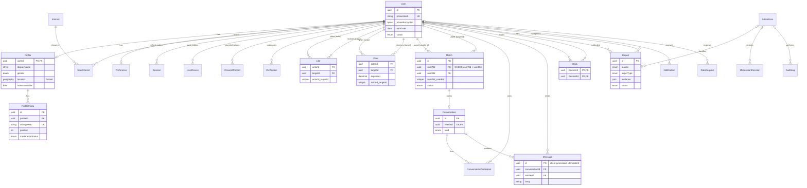
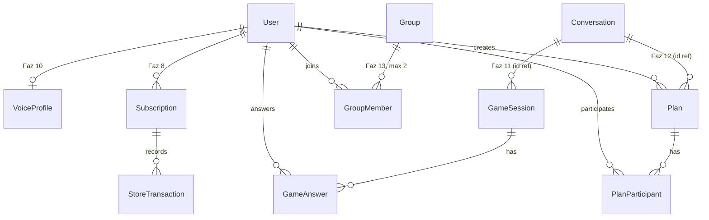

# 03 — Veri Modeli ve İlişki Diyagramı

Şema: [04-schema.prisma](04-schema.prisma) (Prisma 6 ile `prisma validate` geçti, 2026-11-19).

## MVP ilişkileri

`AccessLog` (5651) bilinçli olarak FK'sızdır; kullanıcı silinse de yasal süre boyunca kalır.

## MVP sonrası ilişkiler (taslak)

## Silme davranışı

| İlişki                                                                                                                                   | onDelete | Gerekçe                                                                                                                 |
| ---------------------------------------------------------------------------------------------------------------------------------------- | -------- | ----------------------------------------------------------------------------------------------------------------------- |
| User → Profile, Preference, Photo, Interest seçimi, Session, Device, Consent, Verification, Like, Pass, Match, Participant, Notification | Cascade  | Kişisel veri; hesap kalıcı silinince gider. Medya dosyaları silme işi tarafından ayrıca S3'ten silinir.                 |
| User → Message                                                                                                                           | Cascade  | Silinen kullanıcının mesajları karşı taraftan da kalkar. Şikayet edilmiş mesajın kopyası `Report.evidence`'ta saklanır. |
| User → Report (reporter/reported)                                                                                                        | SetNull  | Şikayet ve kanıt inceleme/yasal süre boyunca kalır; `evidencePurgeAt` ile temizlenir.                                   |
| User → DataRequest                                                                                                                       | SetNull  | Silme talebinin yerine getirildiğinin kanıtı.                                                                           |
| AdminUser → AuditLog, Report, ModerationDecision                                                                                         | SetNull  | Denetim izi admin silinse de kalır (adminler pratikte devre dışı bırakılır, silinmez).                                  |
| Interest → UserInterest                                                                                                                  | Restrict | Katalog öğesi kullanımdaysa silinmez; `isActive=false` yapılır.                                                         |

Hesap silme akışı: `DELETE /users/me` → `status=DELETION_PENDING`, keşfetten anında çıkar, tüm oturumlar iptal → 30 gün sonra worker: S3 medyası sil → `User` sil (cascade) → `DataRequest.completedAt`.

## Önemli kısıtlar ve indeksler

- `Like`/`Pass` `@@unique([actorId, targetId])` → çift beğeni imkânsız; API idempotent.
- `Match` `@@unique([userAId, userBId])` + `CHECK (userAId < userBId)` → aynı çift için tek eşleşme, yön bağımsız.
- `Block` birleşik PK + `blockedId` indeksi → keşfet ve sohbette iki yönlü hızlı filtre.
- `Profile.location` GIST indeksi (PostGIS `ST_DWithin`).
- `Message (conversationId, createdAt DESC)` → cursor sayfalama.
- `ConversationParticipant` → sohbet erişim kontrolünün tek kaynağı.
- Prisma'nın desteklemediği CHECK, extension ve GIST indeksleri migration'da ham SQL (listesi şema başlığında).
