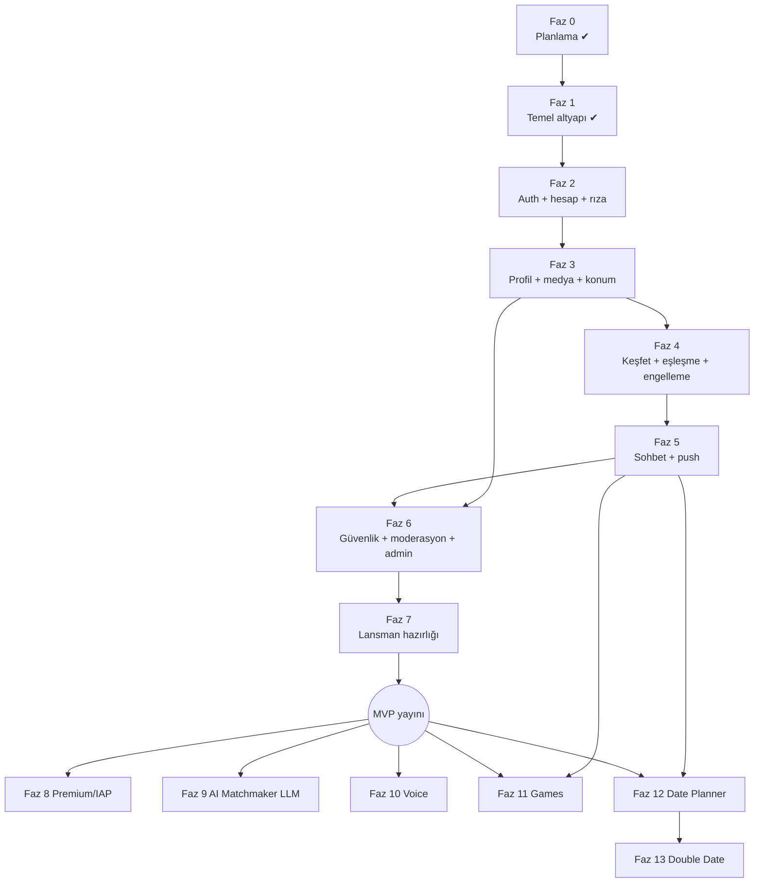

# 06 — Geliştirme Yol Haritası

Her faz küçük, bağımsız test edilebilir ve şu raporla biter (brief §12): değişen dosyalar · çalıştırılacak komutlar · yapılan testler · sonuçlar · bilinen sınırlamalar · sonraki önerilen iş.

## Bağımlılıklar

## MVP fazları

### Faz 1 — Temel altyapı ✅ (2026-11-19, onay bekliyor)

- Monorepo (npm workspaces, K5), `packages/config`, kök script'ler, README, `.env.example`.
- `infra/docker-compose.yml`: PostgreSQL 18 + PostGIS, Redis 8.
- API iskeleti: config doğrulama (Zod), Prisma 7 bağlantısı, ilk migration (PostGIS + `Interest`) ve ilgi alanı tohumu, standart hata biçimi, istek kimliği, pino redaksiyonu, Redis tabanlı rate limit, `/health/live|ready`, Swagger, CORS izin listesi.
- Mobil iskelet: Expo SDK 58, Expo Router (`src/app`), tasarım token'ları + temel bileşenler, API istemcisi + TanStack Query, API bağlantı durumu ekranı.
- CI: biçim, lint, typecheck, build, birim + e2e testleri (gerçek PostGIS/Redis), migration drift kontrolü, expo-doctor.
- **Faz 1'den ertelenenler (gerekçe: henüz kullanan kod yok, boş iskelet yazılmadı):**
  - MinIO / S3 → Faz 3 (fotoğraf yükleme ile).
  - BullMQ worker girişi → Faz 2 (hesap silme işi ile).
  - Sentry (API + mobil) → Faz 2 (DSN ve hesap gerektirir).
  - `packages/api-contract` (OpenAPI → TS tipleri) → Faz 2 (ilk gerçek uçlarla; `openapi-typescript` henüz TypeScript 6'yı desteklemiyor, alternatif değerlendirilecek).
  - Mobil birim testleri (jest-expo) → Faz 2 (ilk iş mantığıyla).

### Faz 2 — Auth, hesap, rıza

- Faz 1'den devralınan: BullMQ worker, Sentry, `packages/api-contract`, jest-expo.
- OTP (console + gerçek SMS adaptörü), Session + refresh rotasyonu + yeniden kullanım tespiti, auth guard.
- Doğum tarihi + 18 yaş kapısı, ConsentRecord, `/app/config`, `UserDevice`.
- Hesap silme talebi + geri alma, silme işi (henüz medya yok).
- Mobil: telefon → kod → doğum tarihi → rızalar akışı, secure-store, otomatik token yenileme.
- **Testler:** OTP doğru/yanlış/süresi dolmuş/deneme limiti, refresh rotasyonu, token yeniden kullanımı, 18 altı reddi, rate limit.
- **Bağımlı kararlar:** #9 SMS sağlayıcı, #15 rıza metinleri (taslak metinle ilerlenebilir).

### Faz 3 — Profil, medya, konum

- Profil CRUD, ilgi alanları, tercihler (özel nitelikli veri rıza kontrolü).
- S3 uyumlu depolama (yerelde MinIO veya alternatifi) ve fotoğraf: presigned yükleme, EXIF temizleme, moderasyon adaptörü (önce sahte/manuel, sonra sağlayıcı), sıralama, silme.
- Konum bulanıklaştırma + rate limit.
- Mobil: onboarding ekranları, fotoğraf seçme/yükleme, profil düzenleme.
- **Testler:** profil oluşturma/düzenleme, fotoğraf yükleme yetkisi (başkasının fotoğrafı, yanlış içerik tipi, boyut), onaysız fotoğrafın görünmemesi, konum yanıtında koordinat olmaması.
- **Bağımlı kararlar:** #2 cinsiyet seçenekleri, #12 moderasyon sağlayıcı.

### Faz 4 — Keşfet, eşleşme, engelleme

- Sert filtreler (PostGIS + SQL), puanlama (saf fonksiyonlar), açıklamalar, cache.
- Like/Pass, karşılıklı eşleşme (transaction + unique yarış testi), unmatch, `GET /matches`.
- Engelleme (keşfet filtresine gerekli olduğu için burada).
- Mobil: kart yığını, like/pass, eşleşme ekranı, eşleşme listesi.
- **Testler:** her filtre kuralı, engellenenin hiç görünmemesi (iki yön), çift like, eşzamanlı karşılıklı like → tek Match, puanlama birim testleri.

### Faz 5 — Sohbet ve bildirim

- Conversation/Participant/Message, REST gönderim, Socket.IO + Redis adapter, okundu bilgisi.
- Push (FCM/APNs), bildirim tercihleri, uygulama içi bildirimler.
- Mobil: sohbet listesi, sohbet ekranı, push izin akışı.
- **Testler:** katılımcı olmayanın erişememesi (REST + socket), engel/unmatch sonrası erişim, mesaj idempotency, sayfalama.

### Faz 6 — Güvenlik, moderasyon, admin

- Şikayet (kanıt anlık görüntüsü, öncelik), metin kontrolleri, selfie doğrulama.
- Admin API + web paneli (AdminUser, TOTP, roller), AuditLog, AccessLog (5651).
- Veri dışa aktarma işi; silme işinin medya dahil tamamlanması.
- **Testler:** şikayet akışı, admin rol yetkileri, audit kaydı, dışa aktarma içeriği, kalıcı silme sonrası veri kalmaması.
- **Bağımlı kararlar:** #1 doğrulama zorunluluğu, #13 admin paneli, #14 doğrulama sağlayıcı.

### Faz 7 — Lansman hazırlığı

- Hukuki metinler, VERBİS, alt işleyici envanteri ve aktarım sözleşmeleri, 5651 süreçleri.
- Mağaza uyumu: 18+ derecelendirme, hesap silme uygulama içinden, gizlilik etiketleri / Data safety, kullanıcı içeriği politikası (engelle/şikayet görünür).
- Yük testi (keşfet sorgusu, socket), güvenlik testi (OWASP MASVS/ASVS kontrol listesi), yedekleme/geri yükleme provası.
- Maestro E2E, EAS production build, kapalı beta (TestFlight / Play internal).
- **Bağımlı kararlar:** #8 barındırma, #15–#18 hukuki.

## MVP sonrası

| Faz | Kapsam                                                                                                                                         | Ön koşul                                                |
| --- | ---------------------------------------------------------------------------------------------------------------------------------------------- | ------------------------------------------------------- |
| 8   | Premium: RevenueCat veya doğrudan mağaza API'leri, webhook, yetki kontrolü, paywall                                                            | MVP; mağaza hesapları, vergi/şirket bilgileri           |
| 9   | AI Matchmaker: LLM ile sohbet tabanlı onboarding, tercih çıkarımı (kullanıcı onayıyla), açıklama zenginleştirme; sağlayıcıdan bağımsız adaptör | MVP; AI sağlayıcısı + yurt dışı aktarım değerlendirmesi |
| 10  | Voice Profile: ≤30 sn kayıt, moderasyon, oynatma                                                                                               | MVP                                                     |
| 11  | Chemistry Games                                                                                                                                | Faz 5                                                   |
| 12  | Date Planner                                                                                                                                   | Faz 5                                                   |
| 13  | Double Date (ikili gruplar, grup sohbeti)                                                                                                      | Faz 12                                                  |

Ana sekmeler (Voice, Planlar) ilgili fazlar bitince açılır.
